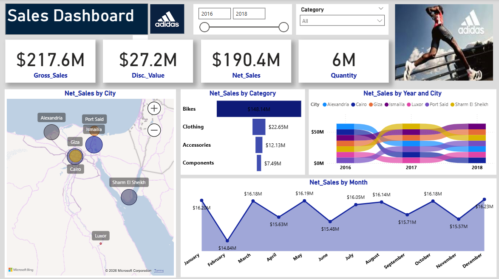

# 📊 Adidas Regional Sales & Revenue Performance Dashboard (Power BI)

## 📌 Project Overview
An interactive **Business Intelligence Dashboard** built with **Microsoft Power BI** to analyze multi-year retail sales performance (**2016 – 2018**) across **7 major cities in Egypt** (**Cairo, Giza, Alexandria, Port Said, Ismailia, Sharm El Sheikh, and Luxor**). 

This solution transforms raw transactional sales records into executive KPIs, helping decision-makers track gross vs. net revenue, evaluate discount strategies, identify top-performing product categories, and monitor seasonal monthly trends.

---

## 🖼️ Dashboard Preview

---

## 🎯 Key Performance Indicators (KPIs) Tracked
* **Gross Sales:** `$217.6M`
* **Total Discount Value:** `$27.2M` (~12.5% overall discount rate)
* **Net Sales (Actual Revenue):** `$190.4M`
* **Total Quantity Sold:** `6M Units`

---

## 🔍 Key Business Insights Uncovered
1. **Product Category Dominance (Pareto Effect):**
   * The **Bikes** category is the primary revenue driver, generating **$148.14M** (**~77.8% of total Net Sales**), followed by **Clothing ($22.65M)**, **Accessories ($12.13M)**, and **Components ($7.49M)**.
2. **Seasonal & Monthly Revenue Trends:**
   * Sales remain resilient throughout the year, peaking in **December ($16.23M)**, **January ($16.20M)**, **May ($16.19M)**, and **March/October ($16.18M)**.
   * A noticeable seasonal dip occurs in **February ($14.84M)** and **June ($15.48M)**, signaling opportunities for targeted promotional campaigns during off-peak months.
3. **Regional Distribution & City Ranking:**
   * A dynamic **Ribbon Chart** and **Geospatial Map** track how sales rankings shift year-over-year (2016–2018) across **Cairo, Giza, Alexandria, Port Said, Ismailia, Sharm El Sheikh, and Luxor**.

---

## 🛠️ Tech Stack & Power BI Features Used
* **Tool:** Microsoft Power BI Desktop
* **Data Transformation (ETL):** Power Query (Data cleaning, data type standardization, handling nulls, and column formatting).
* **Data Modeling & DAX:**
  * Custom DAX measures for `Gross Sales`, `Discount Value`, `Net Sales`, and `Total Quantity`.
  * Dynamic filtering by **Year (2016–2018)** and **Product Category**.
* **Visualizations Used:**
  * KPI Summary Cards for instant executive overview.
  * Geospatial Bubble Map for regional sales distribution across Egypt.
  * Horizontal Bar Chart for category breakdown.
  * Ribbon Chart to track city rank changes over time.
  * Area/Line Chart for monthly seasonality analysis.

---

## 🚀 How to Use This Repository
1. Clone or download this repository.
2. Data (https://drive.google.com/drive/folders/1ZpYQtMIzeRrBUnm06t3eq7gfGncPLpmR?usp=drive_link)
3. Open the `.pbix` file using **Microsoft Power BI Desktop**.
4. Use the top slicers (**Year Slider `2016–2018`** and **Category Dropdown**) to dynamically filter the report.

---

## 📬 Contact & Connect
* **Author:** Mohamed Elkalaf
* **LinkedIn:** [in/mohamed-al-kalaf-305325326](https://www.linkedin.com/in/mohamed-al-kalaf-305325326)
* **Email:** mhmdelkalaf435@gmail.com
